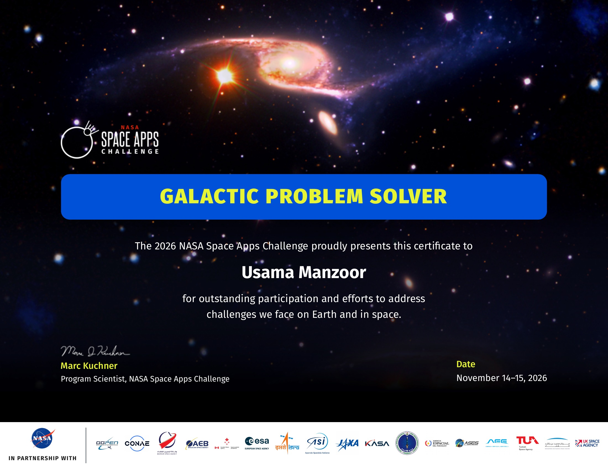

# 🛰️ EarthTrend Detective

**What is changing, where, how much — and is it significant?**

EarthTrend Detective is a free, open-source web tool that turns anyone into an Earth-science data detective.
Pick a place on the map, choose a variable explained in plain language, and the app downloads NASA data live,
draws the long-term time series, measures the rate of change, and runs rigorous significance tests — then explains
the result in everyday words.

Built for the **2026 NASA Space Apps Challenge — “Be An Earth System Trend Detective!”**

🔗 **Live app:** https://iammalik884.github.io/earthtrend-detective/
📦 **Code:** https://github.com/iammalik884/earthtrend-detective

---

## 🏅 Certificate

**Galactic Problem Solver** — 2026 NASA Space Apps Challenge participant certificate awarded to **Usama Manzoor** (Team EarthTrend Copilot), November 14–15, 2026.



[Download the certificate (PDF)](certificate/NASA_Space_Apps_2026_Certificate_Usama_Manzoor.pdf) · [Project page on spaceappschallenge.org](https://www.spaceappschallenge.org/2026/find-a-team/earthtrend-copilot/?tab=project)

## 🎬 Demo

- 30-second demo video: [demo/EarthTrend_Detective_30s.mp4](https://iammalik884.github.io/earthtrend-detective/demo/EarthTrend_Detective_30s.mp4)
- 7-slide presentation: [demo/EarthTrend_Detective_slides.pdf](https://iammalik884.github.io/earthtrend-detective/demo/EarthTrend_Detective_slides.pdf)

## How it answers the challenge

| Challenge objective | How EarthTrend Detective does it |
|---|---|
| Identify Earth science variables that can be investigated | 20 NASA variables in 6 themes (heat, rain & humidity, soil water & drought, plants, sunlight & clouds, wind), each with a simple definition and “why it matters”. A **place-type helper** (city, farmland, desert, rainforest, polar, coast) suggests variables, and the **Variable Scanner** tests all of them at once to find what is trending. |
| Acquire the data for a particular region | Live from NASA APIs, nothing pre-downloaded: **NASA POWER** (MERRA-2 reanalysis + GEWEX SRB/CERES radiation, monthly, 1981–present, 0.5° × 0.625°) and **MODIS Terra MOD13Q1 NDVI** (250 m, 16-day, 2000–present, via ORNL DAAC). Any point on Earth, or a whole region of up to 10° × 10°. |
| Generate and visualize a time series | Interactive charts for annual, seasonal (DJF/MAM/JJA/SON), single-month or deseasonalized monthly series, with the trend line, its 95% confidence band, the least-squares line and any change point. A second chart compares the seasonal cycle of the early vs late record (“which months changed?”). |
| Rate of change and significance (t-test, Mann-Kendall, confidence intervals) | Theil–Sen slope with 95% CI · Mann–Kendall · **modified Mann–Kendall** (Yue & Wang, corrected for autocorrelation) · **seasonal Mann–Kendall** · OLS t-test with 95% CI · **autocorrelation-adjusted** OLS · **Pettitt change-point** test · **Benjamini–Hochberg FDR** for multiple testing · “years of data needed for significance”. |
| Same variable trends differently in different regions | **Trend Map**: runs the full test on every grid cell around your location and colours each cell by its trend, highlighting significant cells — opposite trends inside one region become obvious. |
| Help students become data detectives; demonstration examples | Three guided “detective questions” (where? what? when?), plain-language verdicts, a **Case Files** gallery of 8 one-click investigations (Arctic warming, hot nights in Punjab, greening farmlands, Sahel rainfall, Amazon dry season, Aral Sea, opposite rainfall trends, Lahore urban heat), and a **Learn & Methods** page. |

## Scientific rigour (no shortcuts)

* **Autocorrelation:** climate series are serially correlated, which makes naive tests over-confident. The main yearly test is the Yue–Wang modified Mann–Kendall (applied conservatively — it can only make the test stricter), and the regression test is also reported with an effective-sample-size adjustment (Santer et al., 2000).
* **Seasonality:** monthly data are analysed with the seasonal Mann–Kendall test (Hirsch et al., 1982) and deseasonalized anomalies.
* **Multiple testing:** the Variable Scanner and Trend Map report Benjamini–Hochberg q-values so that “1 in 20 by luck” false alarms are controlled.
* **Robust slope:** Theil–Sen (median of pairwise slopes) is insensitive to single extreme years.
* **Cross-checks:** if the parametric and non-parametric tests disagree, the app warns the user.
* **Data quality:** NASA fill values are removed; years with missing months are excluded from annual/seasonal means; MODIS pixels flagged as fill are dropped and a minimum valid-pixel fraction is required.
* **Validated:** `tests/validate.py` checks every statistical routine in `js/stats.js` against **SciPy** and **pymannkendall** on 80 synthetic series (with ties and autocorrelation). All agree to better than 1 part in a million.

```
$ pip install scipy numpy pymannkendall && python3 tests/validate.py
...
ALL TESTS PASSED
```

## Run it yourself

It is a static site — no server, no API keys, no build step.

```bash
git clone https://github.com/iammalik884/earthtrend-detective
cd earthtrend-detective
python3 -m http.server 8000   # then open http://localhost:8000
```

## Project structure

```
index.html          App shell (5 tabs: Investigate, Variable Scanner, Trend Map, Case Files, Learn)
css/style.css       Responsive dark theme (works on phones)
js/stats.js         Statistics engine (pure JS, no dependencies)
js/data.js          NASA POWER + MODIS (ORNL DAAC) data access and aggregation
js/analysis.js      Analysis pipeline + plain-language verdicts
js/variables.js     Variable catalog, themes, place types
js/content.js       Places, case files, Learn & Methods page
js/app.js           User interface
vendor/             Plotly.js 2.35.2 and Leaflet 1.9.4 (MIT / BSD-2 licences)
tests/validate.py   Validation against SciPy / pymannkendall
tests/ui_test.js    End-to-end UI test with mocked NASA APIs (Playwright)
```

## Data sources & acknowledgements

* **NASA POWER** Project (NASA Langley Research Center), https://power.larc.nasa.gov — monthly point and regional API.
  Meteorology and soil moisture from **MERRA-2** (Gelaro et al., 2017, NASA GMAO); radiation from **GEWEX SRB** and **CERES** (NASA).
* **MODIS/Terra Vegetation Indices 16-Day L3 Global 250 m (MOD13Q1 v6.1)**, Didan (2021), NASA EOSDIS LP DAAC; accessed through the **ORNL DAAC MODIS Web Service**.
* MODIS NDVI for the two farmland demo locations is stored in `data/ndvi_snapshots.json` (downloaded from the ORNL DAAC service with this app's own code) so the Case File opens instantly; every other location is fetched live, which can take a few minutes because the service returns 10 composites per request.
* Map tiles © Esri (World Dark Gray Canvas) with data © OpenStreetMap contributors.

NASA does not endorse this project. This is not an official NASA product.

## Use of AI

This project was developed with the help of an AI coding assistant (Anthropic's Claude), which was used to help write and test code, design the statistical validation, and draft documentation. All data are real NASA data fetched live; no AI-generated images, videos or data are used in the app.

## Team

**EarthTrend Copilot** — Usama Manzoor (team lead), MS Information Technology, University of Sargodha, Pakistan · Syeed Talha (Bangladesh).

## License

MIT — see `LICENSE`.
